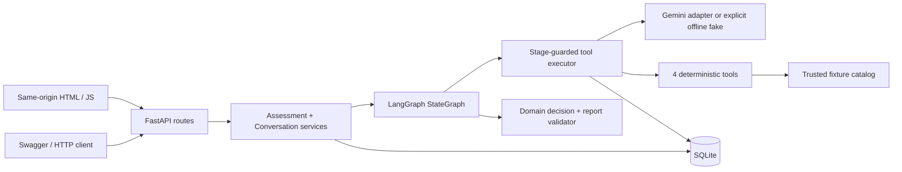
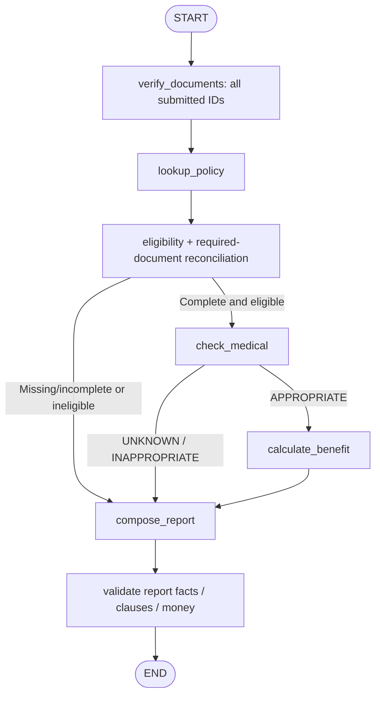
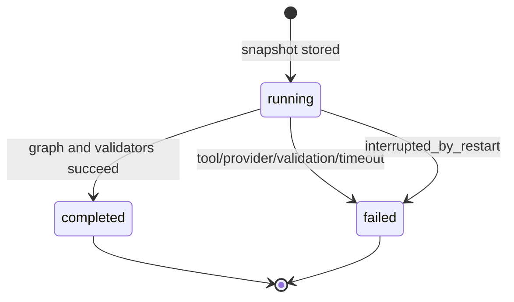

# Kiến trúc hệ thống

## 1. Tổng quan

Modular monolith giúp một reviewer chạy toàn bộ hệ thống bằng một lệnh, nhưng vẫn tách HTTP, application services, domain rules, agent, provider và persistence. FastAPI xử lý request async; LangGraph điều phối workflow có điều kiện; LLM không là nguồn quyết định số tiền.

Entrypoint: `app.main:create_app`. App factory cho phép test inject `Settings` và provider factory mà không sửa production routes. Lifespan mở database/schema và catalog, đóng engine khi shutdown. Provider được tạo theo assessment/chat, đóng trên event loop đã sử dụng để tránh async connection leaks.

## 2. Component boundaries

| Module | Nhận | Trả | Không phụ trách |
| --- | --- | --- | --- |
| `api/routes.py` | Pydantic request, path IDs | Typed model/JSON/Markdown | Tự tính payout |
| `services/assessment.py` | Claim ID, repository/config | Assessment version, review | Viết policy terms |
| `agent/graph.py` | Run-scoped executor/provider, claim | Validated report | HTTP semantics |
| `agent/tools.py` | Exact stage arguments | Tool output + trace | Tự quyết định nhánh routing |
| `domain/rules.py` | Typed claim/policy/evidence | Findings, benefits, recommendation | SDK/API calls |
| `providers/llm.py` | Allowed tool schema hoặc report | Proposal/narrative/chat | Database writes/override |
| `repositories/` | Typed fixture hoặc JSON record | Snapshot/persisted state | Business recommendation |

## 3. LangGraph flow

State dùng `TypedDict` chứa typed claim, document results, policy, verification, medical, benefit và report. Không dùng global claim/session. Graph được compile với closures run-scoped, gọi `ainvoke` với recursion limit 20.

Trong mỗi tool stage, model chỉ nhận schema của tool được phép. Model phát tool proposal; executor validate tên, arguments và stage trước khi gọi function. Proposal sai được ghi `rejected`, sửa tối đa một lần. Mọi proposal đã thực thi có output/error riêng. Medical/benefit chỉ chạy khi nhánh graph cho phép.

## 4. Persistence và nhất quán

- `records`: JSON records theo `kind`, `id`, `parent`; dùng cho sessions, claims, documents, messages, tool calls, model usage và reviews.
- `assessments`: columns có index cho claim/session, version, status; JSON payload chứa immutable snapshot/report.
- Unique `(claim_id, version)` và partial unique index chỉ một `running` run trên mỗi claim.
- Service `busy` set ngăn hai assessment hoặc document update cùng claim trong một process. Đây là lý do chỉ hỗ trợ **một worker**.
- Claim và registry documents được tạo trong một transaction. Tool call ghi ngay khi hoàn tất/rejected/failed. Không giữ transaction qua LLM request.
- Assessment không ghi benefit usage vì chưa payment/reservation. Các assessment khác có thể dùng cùng usage snapshot; không coi số dư này là ledger chi trả.
- Bổ sung tài liệu chỉ attach registry ID thuộc claim, tăng revision. Run cũ giữ snapshot cũ; run mới tăng assessment version.
- Review append-only, lưu original recommendation; không update report.

SQLite schema khởi tạo bằng SQLAlchemy `create_all`, chưa có migration framework. Nếu đổi schema trong tương lai phải thêm migrations; không dựa vào `create_all` để cập nhật database cũ.

## 5. Failure lifecycle

Retry thao tác đánh giá tạo run/version mới. Không resume graph dang dở vì MVP không dùng checkpointer. Startup chuyển mọi run còn `running` thành `failed` với code `interrupted_by_restart`. Một process thứ hai trỏ vào cùng database sẽ phá giả định lifecycle, do đó không chạy song song hai server trên cùng DB.

Upstream exception text không trả ra client vì có thể chứa URL/credentials. Client nhận error code an toàn; runtime log ghi run ID và error type/code. Không lưu private chain-of-thought.

## 6. Giới hạn vận hành

Local demo chưa có auth, tenant isolation, file upload/OCR hoặc production medical rules. Object scoping ngăn nhầm context trong chat/attach; không thay thế authorization. Chỉ bind loopback. Để triển khai nhiều worker cần PostgreSQL, transactional revision/claim locks, migration và cơ chế recovery/queue riêng.
