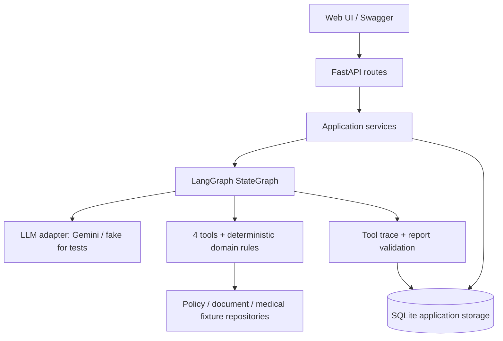

# Kế hoạch MVP — Claim Assessment AI Agent

> Cập nhật sau triển khai (02/11/2026): source P0–P5, docs, tests và offline artifacts đã có.
> Xem `docs/implementation-status.md` để phân biệt bằng chứng đã chạy với live API,
> browser QA và GitHub push còn phụ thuộc môi trường. Các phần “hiện trạng” bên dưới
> được giữ như ghi nhận tại thời điểm lập kế hoạch.

## 1. Mục tiêu và hiện trạng

Xây dựng ứng dụng hội thoại hỗ trợ thẩm định ban đầu hồ sơ bảo hiểm theo `assessments_challenge11.txt`. Người dùng chọn hoặc gửi claim, chạy đánh giá, xem báo cáo có dẫn chứng, hỏi tiếp về kết quả và ghi nhận quyết định của assessor.

Đầu ra là đề xuất `APPROVE`, `REJECT` hoặc `REQUEST_MORE_INFO`; quyết định của người thẩm định được lưu riêng. MVP dùng dữ liệu giả lập, không thực hiện chi trả.

Hiện trạng đã kiểm tra:

- Có `.venv` chạy Python 3.13.13, uv 0.9.13; `requirements.txt` trống.
- Chưa có source app, cấu hình project hoặc Git repository.
- Dùng **uv** cho toàn bộ quản lý dependency và chạy lệnh. Giữ `.venv` hiện tại; không cần cài pip.
- Tài liệu này là thiết kế và kế hoạch triển khai, chưa phải ứng dụng đã chạy hay kết quả kiểm thử.

## 2. Phạm vi MVP hoàn chỉnh

### Bao gồm

1. FastAPI cung cấp REST API, OpenAPI/Swagger và giao diện web đơn giản cùng origin.
2. LangGraph điều phối agent, quản lý state và bắt buộc thứ tự gọi bốn tool của đề.
3. Một LLM API thật cho tool calling, structured output và hội thoại. Đề xuất Gemini qua `langchain-google-genai`; `LLM_MODEL` cấu hình qua môi trường, xác minh model khả dụng khi triển khai.
4. Ba fixture hoàn chỉnh: claim, policy, documents, expected outcome; kèm sample reports và tool logs sinh từ các lần chạy thật.
5. Báo cáo JSON và Markdown với đủ sáu phần theo đề, lý do và citation đến clause cụ thể.
6. Hội thoại theo session: giải thích kết quả, hỏi tài liệu cần bổ sung, nộp metadata bổ sung và chạy lại thành assessment version mới.
7. Assessor xác nhận hoặc override recommendation với lý do; giữ nguyên báo cáo gốc.
8. Lưu SQLite cho session, messages, snapshots, assessments, tool calls và review history. Sau restart vẫn đọc được kết quả đã hoàn tất.
9. Unit/integration/evaluation tests, script demo, README và writeup về system prompt/tool design.

### Giới hạn chủ động

- Document verification dùng metadata/registry fixture có `declared_type`, `actual_type`, completeness và issues. Không tuyên bố có OCR, phát hiện giả mạo hoặc xác minh tài liệu thực tế.
- Medical necessity dùng bảng quy tắc giả lập diagnosis → procedures, có rule ID và nguồn fixture; kết quả ngoài bảng là `UNKNOWN`, chuyển yêu cầu thêm thông tin/assessor review.
- Một loại tiền VND, một claim type trên mỗi claim, điều trị trong một benefit year. Claim vượt năm bị yêu cầu tách hồ sơ.
- Chạy local, một process; chưa có đăng nhập, cloud deployment, vector database, queue hoặc xử lý claim production.
- Không dùng LangGraph checkpoint cho tiến trình đang chạy trong MVP. Run bị gián đoạn được đánh dấu failed khi khởi động lại và có thể chạy lại thành version mới; lưu SQLite của ứng dụng không đồng nghĩa durable graph execution.

## 3. Kiến trúc và lựa chọn kỹ thuật



| Thành phần | Lựa chọn | Trách nhiệm |
| --- | --- | --- |
| Runtime | Python 3.13, uv, `pyproject.toml`, `uv.lock` | Môi trường tái lập |
| HTTP | FastAPI, Uvicorn | Validation, endpoints, static UI |
| Schema/config | Pydantic v2, pydantic-settings | Typed contracts và biến môi trường |
| Agent | LangGraph `StateGraph`, langchain-core | State, routing, tool calling có kiểm soát |
| LLM | langchain-google-genai | Một provider thật, adapter thay thế được |
| Persistence | SQLAlchemy 2 + SQLite/aiosqlite | Async repositories, transactions |
| UI | HTML/CSS/JavaScript thuần | Form, report, chat, tool trace, review |
| Quality | pytest, pytest-asyncio, httpx, Ruff | Tests, API integration, lint/format |

Route chỉ xử lý HTTP; service điều phối use case; domain rules không phụ thuộc FastAPI hoặc LLM. Khởi tạo/đóng database engine và clients qua FastAPI lifespan. Không giữ SQLite transaction mở trong lúc chờ LLM.

Khi triển khai, resolve dependency trên Python 3.13 hiện có rồi commit `uv.lock`. Không tự chọn số version chưa kiểm chứng. CI dùng `uv sync --locked`.

## 4. Mô hình dữ liệu

- `Claim`: ID, policy/member ID, claim type, amount, currency, diagnosis, procedures, treatment start/end, submitted document IDs, revision.
- `Policy`: ID/version, status, insured members, coverage dates, benefit-year usage, benefits, required document types, limits, exclusions, copay, waiting periods và clauses.
- `PolicyClause`: stable clause ID, title, exact text và structured rule tương ứng. Ví dụ `POL-A:v1:DOC-01`.
- `Document`: ID, claim ID, declared/actual type, completeness, issues, metadata revision. Client không được tự ghi đè kết quả xác minh đáng tin cậy.
- `MedicalRule`: ID/version, diagnosis code, allowed procedures, status và explanation; phân biệt nguồn quy tắc y khoa với policy clause.
- `AssessmentState`: messages, claim/policy snapshot, document results, missing documents, eligibility findings, medical result, benefit result, allowed tool stage, tool trace, report/errors.
- `AssessmentReport`: assessment/run/session IDs, versions, six report sections, structured reason codes, citations, missing-information requests, skipped-stage reasons, model/prompt metadata.
- `ToolCall`: sequence, call ID, run ID, tool name, validated inputs, output/error, start/end/duration, attempt.
- `Review`: assessment ID/version, original recommendation, assessor decision, reviewer label, reason, timestamp. Reviewer label là danh tính tự khai trong demo local.

Giá trị tiền dùng `Decimal`, serialize thành chuỗi; không dùng float. Ngày điều trị dùng `date`, timestamps dùng UTC. Mọi lần đánh giá gắn với snapshot bất biến; bổ sung tài liệu tạo revision mới.

## 5. Hợp đồng bốn tool

Expose đúng tên theo đề qua tool schemas; Python implementation có thể dùng snake_case nội bộ.

| Tool | Input công khai | Output chính |
| --- | --- | --- |
| `verifyDocument` | `documentId` | Actual/declared type, complete/incomplete, issues, evidence IDs |
| `lookupPolicy` | `policyId` | Coverage, members, benefits, document requirements, limits, exclusions, copay, waiting periods, clause IDs/text |
| `checkMedicalNecessity` | `diagnosis`, `procedures` | APPROPRIATE / INAPPROPRIATE / UNKNOWN, rule IDs, explanation |
| `calculateBenefit` | `policyId`, `claimType`, `amount` | Eligible base, covered amount, copay, remaining limit before/after, member responsibility, cited clauses |

Claim/member/date, policy version và usage snapshot được inject bằng context do server kiểm soát. Đặc biệt `calculateBenefit` không thể suy ra đúng remaining limit chỉ từ ba tham số công khai; phải dùng snapshot của run. Không dùng biến global cho claim hiện tại. Không chấp nhận policy/document ID thuộc claim khác.

Policy lookup là nguồn duy nhất cho điều khoản. Document/medical rules và các phép kiểm tra deterministic cung cấp evidence; LLM không tạo thêm quyền lợi hoặc quy tắc.

## 6. LangGraph và vai trò agent

Luồng đề xuất:

```text
START → validate_claim
      → verify_all_submitted_documents
      → lookup_policy
      → validate_policy_and_required_documents
      → [eligible + đủ tài liệu] check_medical_necessity
      → [appropriate] calculate_benefit
      → decide_recommendation
      → compose_structured_report
      → validate_report
      → persist_result → END
```

- Agent được bind tool phù hợp từng stage; LLM phát tool call và executor kiểm tra tên/args/sequence trước khi chạy. LangGraph giữ routing, không giao toàn bộ workflow cho model.
- Stage documents xử lý đủ danh sách ID duy nhất theo thứ tự ổn định. Validate tập document IDs đã gọi bằng tập submitted IDs trước khi sang policy. Giới hạn attempts ngăn lặp vô hạn.
- Phải gọi `verifyDocument` cho mọi tài liệu đã nộp, kể cả khi một tài liệu trước đó không hoàn chỉnh. Tool lỗi được ghi nhận; không giả lập kết quả thành công.
- Sau lookup mới đối chiếu document types với yêu cầu policy. Tài liệu chưa nộp được tạo dòng `missing` trong report; không gọi verifier với ID tưởng tượng.
- Trên happy path dùng đủ bốn tool theo thứ tự đề. Với thiếu tài liệu hoặc chắc chắn không đủ điều kiện, dừng các tool downstream không còn hữu ích; ghi `NOT_EVALUATED` và lý do trong đúng section báo cáo. Đây là cách diễn giải hai yêu cầu “không bỏ bước” và “không gọi thừa”: mọi stage được thể hiện, tool chỉ chạy khi có tiền điều kiện.
- Tool call sai args/stage được từ chối và cho model sửa tối đa một lần. Hết attempts → run failed, không sinh recommendation thành công giả.
- Decision và tiền do domain rules xác định; model diễn giải dựa trên facts. Không cho structured output của model thay đổi decision hoặc amounts.
- Report validator kiểm tra schema, mọi reason có citation hợp lệ và khớp rule/evidence, số tiền khớp kết quả tool. Có thể repair phần diễn giải tối đa một lần; vẫn sai thì báo lỗi.
- Chat đọc snapshot/report/tool facts theo session. Câu hỏi giải thích không chạy lại tools; yêu cầu sửa claim/bổ sung tài liệu phải qua schema validation rồi tạo assessment mới. Chat không tự override quyết định.

## 7. Quy tắc nghiệp vụ và tính tiền

### Thứ tự ưu tiên recommendation

1. Input sai định dạng → HTTP 422; policy/document không tồn tại → lỗi dữ liệu cụ thể. Lỗi API/LLM/tool là run failure, không tự biến thành từ chối hoặc thiếu hồ sơ.
2. Thiếu, incomplete hoặc sai loại tài liệu bắt buộc → `REQUEST_MORE_INFO`, kể cả khi đồng thời phát hiện điều kiện loại trừ. Liệt kê các findings khác để assessor xem, chưa chốt reject.
3. Đủ tài liệu nhưng policy không hiệu lực tại thời điểm điều trị, member không thuộc policy, claim type không được bảo hiểm, đang waiting period hoặc thuộc exclusion → `REJECT` với clause chính xác.
4. Medical `UNKNOWN` → `REQUEST_MORE_INFO` theo clause yêu cầu bằng chứng y khoa; `INAPPROPRIATE` → `REJECT` chỉ khi policy có clause tương ứng.
5. Hợp lệ và covered amount > 0 → `APPROVE`, kèm số tiền được đề xuất chi trả. Hết quyền lợi → `REJECT` theo clause limit.

Coverage kiểm tra toàn bộ khoảng điều trị nằm trong coverage period, bao gồm hai biên; waiting period tính theo mốc ghi trong policy. Không dùng ngày hiện tại để quyết định một claim điều trị trong quá khứ. Fixture và rule phải quy định cách xử lý status/lapse theo ngày hiệu lực.

### Công thức fixture MVP

Chốt policy minh họa: copay áp dụng trước, annual limit giới hạn phần insurer payout; không có deductible, item-level pricing hoặc per-claim sublimit trong baseline.

```text
A = submitted amount (đã đủ điều kiện, VND)
c = copay rate, 0 <= c <= 1
L = max(annual payout limit - used insurer payout, 0)
copay = round_half_up(A * c, 1 VND)
eligible_insurer_amount = A - copay
covered_amount = min(eligible_insurer_amount, L)
limit_excess = eligible_insurer_amount - covered_amount
member_responsibility = copay + limit_excess
remaining_limit_after = L - covered_amount
```

Invariant: `covered_amount + member_responsibility == A`, `covered_amount <= L`, các thành phần không âm. Assessment không cập nhật used benefit vì chưa chi trả. Nếu A vượt limit nhưng còn quyền lợi, cho partial approval theo policy fixture; không mặc định reject toàn bộ. Case rejection chính dùng exclusion để tránh mơ hồ này.

Khi chưa tính được benefit, các giá trị không biết là `null`, status `NOT_EVALUATED`; không ghi zero như thể đã tính.

## 8. Ba test case bắt buộc

Mỗi case là bộ JSON tự đủ, ngày cố định, không chứa dữ liệu cá nhân thật. Có điều khoản riêng về coverage/member/benefit/documents/medical necessity/exclusion/limit/copay/waiting period, không đặt citation chỉ trong expected output.

| Case | Claim và policy | Documents | Kết quả mong đợi |
| --- | --- | --- | --- |
| `approval_001` | Outpatient, viêm họng, khám + xét nghiệm phù hợp; điều trị 10/06/2026; policy 01/01–31/12/2026; waiting 30 ngày; A=1.000.000, copay 20%, annual limit=5.000.000, used=1.000.000 | Claim form, invoice, medical report đều complete/đúng loại | APPROVE; payout=800.000, copay/member=200.000, limit sau=3.200.000 |
| `rejection_002` | Outpatient, thủ thuật thẩm mỹ không do tai nạn, A=3.000.000; member và ngày hợp lệ; exclusion `EXC-COSMETIC` rõ ràng | Đủ ba tài liệu | REJECT do exclusion; medical/benefit NOT_EVALUATED có lý do |
| `more_info_003` | Outpatient, viêm họng, A=1.000.000; policy/member/date hợp lệ | Có claim form + invoice; thiếu medical report bắt buộc | REQUEST_MORE_INFO; gọi verifier cho cả hai tài liệu đã nộp; nêu medical report missing và clause yêu cầu |

Với cases 2/3 vẫn định nghĩa đầy đủ benefit/limit/copay/waiting period/medical rules dù nhánh thực thi không cần dùng hết. Không đặt expected outcome vào prompt/context của agent.

Test bổ sung: wrong document type, incomplete required document, mọi tài liệu đều được kiểm tra, coverage boundaries, treatment end vượt coverage, waiting period, member mismatch, exhausted limit, partial approval, duplicate/foreign document IDs, medical unknown, citation bịa, tool failure, model gọi sai thứ tự, precision/rounding, session isolation và restart persistence.

## 9. API và trải nghiệm demo

| Endpoint | Chức năng |
| --- | --- |
| `GET /health` | Liveness, không gọi LLM |
| `GET /ready` | Database/config readiness; không mặc định chứng minh API key thật còn hoạt động |
| `GET /api/v1/demo-cases` | Danh sách ba case để UI chọn |
| `POST /api/v1/sessions` | Tạo session |
| `POST /api/v1/claims` | Tạo claim từ input typed hoặc fixture |
| `POST /api/v1/claims/{id}/assessments` | Chạy đồng bộ có timeout, trả assessment và report |
| `GET /api/v1/assessments/{id}` | Đọc report đã lưu |
| `GET /api/v1/assessments/{id}/tool-calls` | Tool trace theo sequence |
| `POST /api/v1/sessions/{id}/messages` | Chat có liên kết claim/assessment hợp lệ |
| `POST /api/v1/claims/{id}/documents` | Bổ sung metadata document, tạo claim revision |
| `POST /api/v1/assessments/{id}/reviews` | Confirm/override, reviewer label + lý do bắt buộc |

UI tại `/`: chọn fixture → xem claim/docs → Assess → đọc sáu phần report và citations → mở tool trace → hỏi tiếp → confirm/override. Có loading/error/retry, hiển thị rõ run mode và skipped stages. Swagger tại `/docs` đủ để chạy toàn bộ API bằng tay.

MVP dùng request/response đồng bộ async với timeout tổng, giới hạn attempts và khóa một assessment đang chạy trên cùng claim. Không cần background queue/SSE. Duplicate submission khi đang chạy trả 409. Không bật CORS wildcard; bind mặc định `127.0.0.1`.

## 10. Cấu trúc project dự kiến

```text
app/
  main.py
  api/routes/                 # sessions, claims, assessments, messages, reviews
  core/                      # settings, errors, logging
  domain/                    # schemas, eligibility, money, recommendation, citations
  agent/                     # graph, state, nodes, prompts, tool schemas/executor
  services/                  # assessment, conversation, review
  providers/                 # LLM interface, Gemini adapter, explicit test fake
  repositories/              # fixture loaders, SQLite models/repositories
  static/                    # index.html, styles.css, app.js
data/
  cases/                     # 3 self-contained fixture bundles
  medical_rules.json
tests/
  unit/
  integration/
  evaluation/
scripts/
  run_demo.py
artifacts/
  live/                      # sanitized actual API reports + logs + run metadata
  offline/                   # explicitly labeled fake-provider outputs
docs/
  design.md                  # prompt/tool decisions and assumptions
plan.md
AGENTS.md                    # file agents.md requested; canonical agent filename
README.md
.env.example
.gitignore
.python-version
pyproject.toml
uv.lock
```

## 11. Các giai đoạn triển khai và tiêu chí hoàn tất

### P0 — Khởi tạo project

- Tạo `pyproject.toml`, pin Python 3.13, chọn dependency versions tương thích bằng uv, tạo lockfile.
- Thêm settings, `.env.example`, `.gitignore`, health route, app lifespan, SQLite schema initialization và static page.
- Dùng `.venv` hiện tại. `requirements.txt` trống không là nguồn dependency thứ hai; nếu cần export sau này phải sinh từ uv.
- Hoàn tất khi `uv sync --locked` và `uv run uvicorn app.main:app --reload` hoạt động, `/health` trả 200.

### P1 — Domain, fixtures và tools

- Định nghĩa typed models, clause registry và ba bộ dữ liệu.
- Viết bốn tool, eligibility/document checks, benefit math, citation mapping và trace wrapper.
- Hoàn tất khi unit tests chứng minh outcomes/công thức/boundaries và mọi tool trả output typed, có sources.

### P2 — Agent LangGraph

- Xây graph, LLM adapter thật, fake adapter cho tests, system prompt, stage guards và report validators.
- Bổ sung timeout/retry có giới hạn; log lỗi, usage và model/prompt version nếu provider cung cấp.
- Hoàn tất khi graph tests kiểm tra đúng thứ tự, đủ documents, branch skips, decision và citations; có live smoke test riêng khi có key.

### P3 — API, persistence, chat và review

- Kết nối endpoints với services/repositories; lưu snapshots, tool calls, report và messages.
- Bổ sung session isolation, revision flow và review history.
- Hoàn tất khi API integration tests thực hiện được tạo claim → assess → chat → bổ sung tài liệu → reassess → review; đọc lại report sau restart.

### P4 — UI và demo end-to-end

- Làm giao diện cùng origin, đủ form/report/chat/trace/review, trạng thái lỗi và loading.
- Hoàn tất khi chạy cả ba fixture từ UI và `/docs`, có thể giải thích từng outcome bằng citations/tool evidence.

### P5 — Evaluation và bàn giao

- Script `uv run python scripts/run_demo.py --mode live` chạy ba case, kiểm outcome/schema/citations/sequence và xuất JSON report, Markdown report, JSONL tool logs, manifest.
- `--mode offline` dùng fake provider để tái lập tests không cần key; mode được ghi rõ trong mọi artifact. Không fallback âm thầm từ live sang fake.
- Manifest chứa run time, fixture/policy/prompt versions hoặc hashes, model ID, mode, kết quả pass/fail; không lưu secrets hay hidden chain-of-thought.
- Viết README setup/demo và `docs/design.md` giải thích system prompt, tool contracts, assumptions, hạn chế mocks và nhánh dừng sớm.
- Chạy quality gates, làm sạch secrets/dữ liệu thật, chuẩn bị source để nộp GitHub. Push cần remote và quyền truy cập do người dùng cung cấp; không tự tạo remote giả định.
- Live evaluation chỉ được báo đã pass khi có API key hợp lệ và artifact sinh từ API thật. Nếu chưa có key, ghi rõ phần chưa xác minh dù offline suite đã pass.

## 12. Lệnh dự kiến sau khi có implementation

Các lệnh dưới đây là mục tiêu hướng dẫn vận hành; source/config/scripts tương ứng sẽ được tạo ở các phase trên.

```powershell
# Dependency thay đổi trong quá trình phát triển
uv add fastapi "uvicorn[standard]" langgraph langchain-core langchain-google-genai pydantic pydantic-settings sqlalchemy aiosqlite
uv add --dev pytest pytest-asyncio httpx ruff

# Sau khi đã commit pyproject.toml + uv.lock
uv sync --locked
Copy-Item .env.example .env
# Điền GOOGLE_API_KEY, LLM_MODEL; .env không commit
uv run uvicorn app.main:app --reload --host 127.0.0.1

# Quality gates
uv lock --check
uv run ruff check .
uv run ruff format --check .
uv run pytest

# Evaluation
uv run python scripts/run_demo.py --mode offline
uv run python scripts/run_demo.py --mode live
```

Nếu scripts PowerShell không cho activate venv, vẫn chạy được qua `uv run`; không cần thay execution policy. Không xóa/tạo lại `.venv` chỉ vì thiếu pip.

## 13. Definition of Done

- [ ] Clone/setup theo README trên Windows Python 3.13, chỉ dùng uv.
- [ ] FastAPI + LangGraph chạy thật, live mode gọi LLM API thật.
- [x] Ba case có đủ input, expected outcome, actual report và actual tool logs (offline mode).
- [x] Happy path dùng đủ bốn tools; mọi run thành công kiểm tra toàn bộ submitted documents.
- [x] Coverage/member/claim type/waiting period/exclusion được kiểm tra bằng rules có clause.
- [x] Missing/incomplete/wrong-type required documents dẫn đến REQUEST_MORE_INFO.
- [x] Không payout vượt limit; rounding và member responsibility chính xác.
- [x] Báo cáo đủ sáu phần; mỗi recommendation reason truy được đến policy clause và evidence tương ứng.
- [x] Chat có context; reassessment tạo version mới; review không sửa báo cáo gốc.
- [x] App restart vẫn đọc được kết quả/review history; run dang dở được nhận diện.
- [x] Tests/lint/format pass; live/offline evidence được phân biệt trung thực.
- [x] README, prompt/tool writeup, `.env.example`, lockfile, sanitized offline artifacts sẵn sàng nộp GitHub.

## 14. Tài liệu kỹ thuật đối chiếu

- [LangGraph workflows và agents](https://docs.langchain.com/oss/python/langgraph/workflows-agents): cơ sở cho graph có routing kiểm soát và model tool calling.
- [Gemini integration](https://docs.langchain.com/oss/python/integrations/chat/google_generative_ai): adapter, tool calling và structured output; kiểm chứng tiếp model/dependency khi cài.
- [FastAPI lifespan](https://fastapi.tiangolo.com/advanced/events/): lifecycle resources.
- [uv locking và syncing](https://docs.astral.sh/uv/concepts/projects/sync/): quản lý môi trường/lockfile bằng uv.
- [LangGraph package metadata](https://pypi.org/project/langgraph/) và [FastAPI package metadata](https://pypi.org/project/fastapi/): có khai báo hỗ trợ Python 3.13; vẫn cần resolve và smoke test toàn bộ dependency thực tế.
